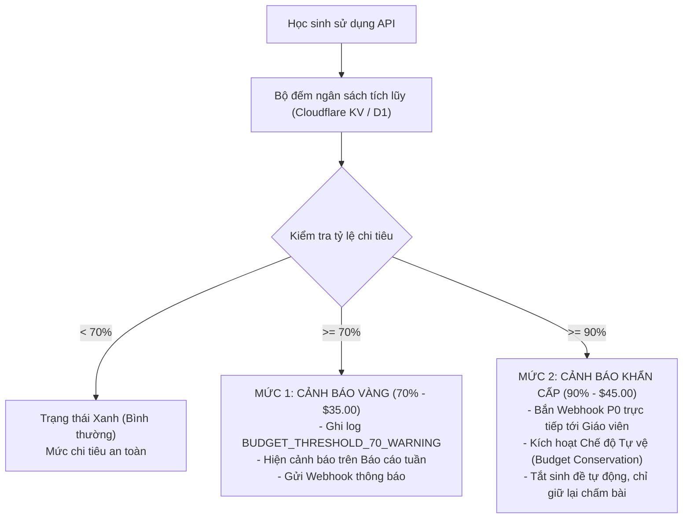

# CHÍNH SÁCH HẠN MỨC NGƯỜI DÙNG & QUẢN TRỊ NGÂN SÁCH AI (BUDGET & QUOTAS)
**Tài liệu vận hành tài chính & an toàn hệ thống — Nền tảng PUMKIN.DEV**  
*Mã tài liệu: FIN-GOV-01 — Phiên bản: 1.0 — Ngày ban hành: 21/10/2026*

---

## 1. HẠN MỨC THEO NGƯỜI DÙNG / NGÀY (DAILY USER QUOTAS)

Để chống lạm dụng, ngăn chặn bot cào dữ liệu tự động và khuyến khích học sinh tự tư duy thay vì phụ thuộc vào AI giải hộ, hệ thống áp dụng hạn mức tính toán theo ngày cho mỗi thiết bị/phiên học:

| Loại thao tác | Hạn mức / ngày | Cơ chế kiểm tra | Hành vi khi vượt hạn mức |
| :--- | :---: | :--- | :--- |
| **Giải đề tự nhập (`/solve`)** | **50 lượt / ngày** | `localStorage` (`pumkin_daily_math_quota_v1`) kết hợp IP sliding window | Khóa nhập đề tự do; hiển thị thông báo sư phạm: *"Bạn đã hoàn thành 50 lượt giải toán hôm nay! Hãy nghỉ ngơi một chút hoặc tự luyện tập trong kho đề nhé."* |
| **Chấm bài tự luận (`/check`)** | **100 lượt / ngày** | Bộ đếm phiên + Gateway Rate Limiter | Chuyển sang so chuỗi chuẩn hóa cục bộ (0ms, không tốn quota API) |
| **Sinh đề đẳng cấu (`/generate`)** | **15 bộ / ngày** | Hàng đợi Prefetch Queue | Chuyển tự động sang câu hỏi cùng dạng trong ngân hàng đề chuẩn |

---

## 2. NGÂN SÁCH LLM VÀ HẠ TẦNG TỔNG

- **Hạn mức ngân sách tháng tối đa (Monthly Cap):** **$50.00 USD / tháng** (~1,270,000 VNĐ).
- **Mô hình định giá tài nguyên vận hành:**
  - *Cloudflare Pages Functions (Gateway):* $0.15 / 1,000,000 requests.
  - *Mô hình ngôn ngữ Gemini 1.5 Flash:* $0.075 / 1,000,000 input tokens; $0.30 / 1,000,000 output tokens.
  - *Máy chủ CAS Engine (Render Starter instance):* $7.00 USD / tháng.

---

## 3. CƠ CHẾ CẢNH BÁO VƯỢT NGƯỠNG (70% VÀ 90%)

Hệ thống thiết lập 2 mốc cảnh báo tự động:



### 3.1. Mức 1: Cảnh báo Vàng khi chạm ngưỡng 70% ($35.00 / $50.00)
- **Kênh thông báo:**
  1. **Báo cáo tuần (`tools/generate_weekly_telemetry_report.py`):** Xuất hiện thẻ cảnh báo màu vàng tại Mục 6 (Mức dùng ngân sách) kèm ngày dự kiến cạn kiệt ngân sách nếu giữ nguyên tốc độ tiêu thụ.
  2. **Webhook thông báo quản trị viên:** Nếu biến môi trường `ALERT_WEBHOOK_URL` được thiết lập (Discord / Telegram / Slack / Email), hệ thống tự động phát tin nhắn:
     ```
     ⚠️ [PUMKIN BUDGET ALERT] Chi tiêu AI tháng này đã đạt 70% ($35.12 / $50.00).
     Dự kiến cần xem xét gia hạn hạn mức trước ngày 28 của tháng.
     ```

### 3.2. Mức 2: Cảnh báo Khẩn cấp & Chế độ Tự vệ khi chạm ngưỡng 90% ($45.00 / $50.00)
- **Kênh thông báo:**
  1. **Bắn thông báo P0 tức thì** qua Webhook và email tới Thầy/Cô.
  2. **Hiển thị Banner trên Dashboard quản trị:** *"Hệ thống đang hoạt động ở Chế độ Tiết kiệm Ngân sách (Budget Conservation Mode)."*
- **Hành vi Tự vệ Kỹ thuật (Budget Conservation Mode):**
  - Tự động **TẮT** cờ `math.generate`: Toàn bộ các yêu cầu sinh đề tự động đẳng cấu được chuyển hướng sang lấy đề có sẵn từ ngân hàng 553 câu hỏi chuẩn.
  - **Bảo lưu 10% ngân sách còn lại ($5.00)** dành riêng cho luồng chấm bài tự luận học sinh nộp (`/check`), tuyệt đối không làm gián đoạn bài thi của học sinh.
