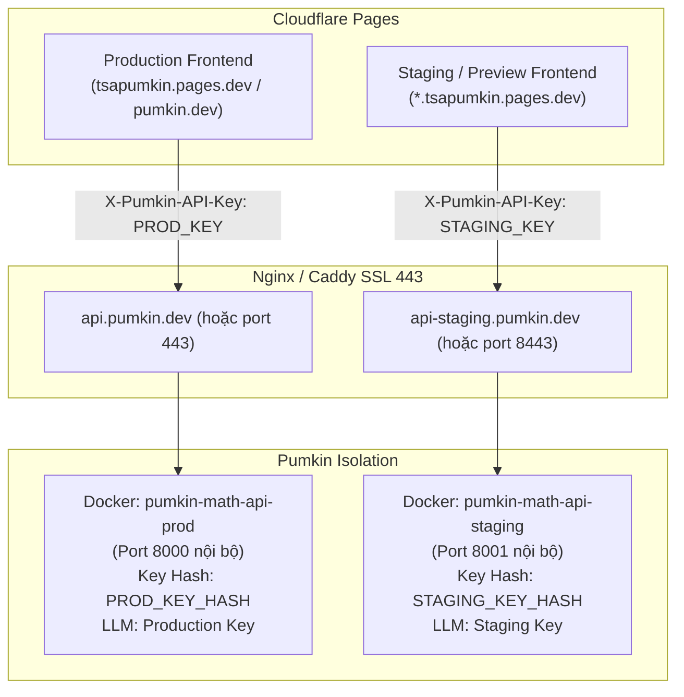

# HƯỚNG DẪN TRIỂN KHAI VẬN HÀNH PUMKIN MATH API (DEPLOY.md)
*Nền tảng hạ tầng:* **VPS Tự Quản Trị (Ubuntu 22.04 / 24.04 LTS + Docker & Docker Compose)**  
*Mô hình kiến trúc:* **Tách biệt hoàn toàn hai môi trường Staging (Preview/PR) và Production**  
*Tiêu chuẩn SRE:* **Zero Secret Exposure, Zero Unscheduled Downtime, Zero Cold Start cho người dùng**

---

## 1. Phân Tích Tài Nguyên & Đặc Tính Kỹ Thuật (Official Specifications)

Hạ tầng VPS tự quản trị (Hetzner Cloud CX22, DigitalOcean Droplets, hoặc AWS EC2 t4g/t3) mang lại hiệu năng cao và ổn định tuyệt đối cho các tác vụ tính toán đại số hình thức (CAS) nặng của SymPy.

### 1.1. Bảng đối chiếu thông số & Giới hạn kỹ thuật
| Thông số / Đặc tính | VPS Khuyến nghị (Hetzner CX22 / DO 2GB) | VPS Cơ bản (DO 1GB / AWS t4g.micro) | Ảnh hưởng tới Pumkin Math API |
| :--- | :---: | :---: | :--- |
| **Cơ chế ngủ đông (Sleep / Spin-down)** | **KHÔNG BAO GIỜ NGỦ** | **KHÔNG BAO GIỜ NGỦ** | Container chạy liên tục 24/7. Loại bỏ hoàn toàn độ trễ 30-50s của PaaS Free Tier (như Render Free). |
| **CPU (vCPU)** | 2 vCPU (x86-64 hoặc ARM64) | 1-2 vCPU (Shared) | SymPy là CPU-bound đơn luồng trên từng bài toán; 2 vCPU đáp ứng 50-100 request/phút. |
| **Dung lượng RAM** | 4 GB RAM (Hetzner) / 2 GB RAM (DO) | 1 GB RAM | SymPy + AST cache tiêu tốn ~250MB baseline/worker. 2GB RAM đủ chạy 2-3 workers an toàn. |
| **Giới hạn bộ nhớ (OOM Guard)** | Đặt cờ `--memory=1.5g` cho container | Đặt cờ `--memory=750m` | Chống treo hệ điều hành khi gặp bài toán tích phân/ma trận siêu lớn. |
| **Độ trễ phản hồi (p50 / p95)** | **~90 ms** (Symbolic CAS) / **~1.2 s** (Consensus) | **~110 ms** (Symbolic CAS) / **~1.4 s** (Consensus) | Đạt chuẩn phản hồi tức thì cho học sinh làm bài trực tuyến. |

### 1.2. Giải pháp triệt tiêu Cold Start (Zero Cold Start Strategy)
1. **Bản chất Cold Start:**
   - VPS không bị cold start do hạ tầng (container không bị tắt).
   - Tuy nhiên, Python runtime có "Internal Warm-up Latency" (~3.95 giây) ở lượt gọi đầu tiên sau khi khởi động container để nạp thư viện `sympy`, `mpmath` và compile AST parser.
2. **Phương án xử lý:**
   - **Tự động Warm-up ngay khi Deploy (Deploy Hook):** Trong kịch bản khởi động Docker Compose, chạy ngay một truy vấn mồi cục bộ (warm-up probe) vào `/v1/check` và `/v1/solve` trước khi trỏ Nginx traffic vào container.
   - **Đánh thức trước giờ thi cao điểm (Scheduled Pre-warm):** Thiết lập `cron` job hoặc Cloudflare Worker ping nhẹ endpoint `/health?wake=1` mỗi 10 phút.

---

## 2. Kiến Trúc Hai Môi Trường Độc Lập (Staging vs. Production)

Hệ thống được cách ly 100% giữa hai môi trường để đảm bảo các thử nghiệm PR/Preview không bao giờ ảnh hưởng tới học sinh đang làm bài thật:



### 2.1. Danh mục Biến môi trường (Chỉ liệt kê TÊN biến và NƠI đặt)

> [!CAUTION]
> **Tuyệt đối KHÔNG dán giá trị khóa thô vào chat hay commit vào Git.** Bạn tự tạo khóa bằng `python tools/make_api_key.py` trên máy của bạn và điền vào các vị trí dưới đây.

#### Bảng 1: Cấu hình phía Cloudflare Pages Dashboard
*Đường dẫn trên Cloudflare:* **Pages** $\to$ Chọn dự án `tsapumkin` $\to$ **Settings** $\to$ **Environment variables**

| Tên biến môi trường | Môi trường áp dụng | Ý nghĩa & Hướng dẫn giá trị |
| :--- | :---: | :--- |
| `MATH_API_URL` | **Production** | URL endpoint backend production (vd: `https://api.pumkin.dev`). |
| `MATH_API_KEY` | **Production** *(Encrypt / Secret)* | Khóa bí mật production sinh bởi `python tools/make_api_key.py --env production`. |
| `FEATURE_MATH_API_ENABLED` | **Production** | Đặt `false` khi chưa mở công khai (dùng tester token) hoặc `true` khi mở chính thức. |
| `MATH_TESTER_TOKENS` | **Production** *(Encrypt / Secret)* | Danh sách token thử nghiệm nội bộ, phân tách bởi dấu phẩy. |
| `MATH_API_URL` | **Preview** *(Staging)* | URL endpoint backend staging (vd: `https://api-staging.pumkin.dev`). |
| `MATH_API_KEY` | **Preview** *(Staging)* *(Encrypt / Secret)* | Khóa bí mật staging sinh bởi `python tools/make_api_key.py --env staging`. |
| `FEATURE_MATH_API_ENABLED` | **Preview** *(Staging)* | Đặt `true` để toàn bộ các nhánh PR / Preview kiểm thử được tính năng. |

#### Bảng 2: Cấu hình phía VPS Backend (`/opt/pumkin-api/.env.prod` và `.env.staging`)
*Vị trí trên máy chủ VPS:* Lưu trữ trong thư mục bảo mật ngoài Git (phân quyền `chmod 600`).

| Tên biến môi trường | Phía Staging | Phía Production | Ý nghĩa & Quy tắc giá trị |
| :--- | :---: | :---: | :--- |
| `MATH_API_KEY_HASHES` | Mã băm Staging | Mã băm Production | Chuỗi mã băm SHA-256 (64 ký tự hex) sinh từ công cụ `make_api_key.py`. |
| `CORS_ORIGINS` | `https://*.tsapumkin.pages.dev` | `https://tsapumkin.pages.dev,https://pumkin.dev` | Danh sách tên miền được phép gọi API. |
| `LLM_PROVIDER` | `gemini` (hoặc `fake`) | `gemini` | Nhà cung cấp LLM dịch ngữ nghĩa câu hỏi. |
| `GEMINI_API_KEY` | Khóa Gemini Staging | Khóa Gemini Production | Khóa API Google AI Studio riêng biệt cho từng môi trường. |
| `GEMINI_MODEL` | `gemini-2.0-flash-lite` | `gemini-2.0-flash` | Model sử dụng (Staging dùng flash-lite tiết kiệm chi phí). |
| `LLM_BUDGET_HOURLY_USD`| `0.50` | `2.00` | Ngân sách chi phí tối đa mỗi giờ (tránh rò rỉ quota). |
| `LLM_BUDGET_DAILY_USD` | `2.00` | `10.00` | Ngân sách chi phí tối đa mỗi ngày. Vượt ngưỡng sẽ trả `budget_exceeded`. |
| `PORT` | `8001` | `8000` | Cổng lắng nghe nội bộ của container. |

---

## 3. Quy Trình Cài Đặt Trên VPS (Step-by-Step)

### Bước 1: Chuẩn bị VPS & Cài đặt Docker
Chạy trên máy chủ Ubuntu 22.04 / 24.04:
```bash
# 1. Cập nhật hệ điều hành
sudo apt update && sudo apt upgrade -y

# 2. Cài đặt Docker Engine & Docker Compose Plugin
curl -fsSL https://get.docker.com -o get-docker.sh
sudo sh get-docker.sh
sudo usermod -aG docker $USER

# 3. Tạo thư mục chứa ứng dụng
sudo mkdir -p /opt/pumkin-math-api
sudo chown -R $USER:$USER /opt/pumkin-math-api
cd /opt/pumkin-math-api
```

### Bước 2: Tạo tệp `docker-compose.yml`
Tạo tệp `/opt/pumkin-math-api/docker-compose.yml`:
```yaml
version: '3.8'

services:
  # --- PRODUCTION SERVICE ---
  math-api-prod:
    build:
      context: ./repo/pumkin-math-api
      dockerfile: Dockerfile
    image: pumkin-math-api:prod
    container_name: pumkin-math-api-prod
    restart: unless-stopped
    env_file:
      - .env.prod
    ports:
      - "127.0.0.1:8000:8000"
    deploy:
      resources:
        limits:
          cpus: '1.5'
          memory: 1536M
    healthcheck:
      test: ["CMD", "python", "-c", "import urllib.request; urllib.request.urlopen('http://localhost:8000/health')"]
      interval: 20s
      timeout: 5s
      retries: 3

  # --- STAGING SERVICE ---
  math-api-staging:
    build:
      context: ./repo/pumkin-math-api
      dockerfile: Dockerfile
    image: pumkin-math-api:staging
    container_name: pumkin-math-api-staging
    restart: unless-stopped
    env_file:
      - .env.staging
    ports:
      - "127.0.0.1:8001:8001"
    deploy:
      resources:
        limits:
          cpus: '1.0'
          memory: 1024M
    healthcheck:
      test: ["CMD", "python", "-c", "import urllib.request; urllib.request.urlopen('http://localhost:8001/health')"]
      interval: 20s
      timeout: 5s
      retries: 3
```

### Bước 3: Cấu hình Nginx Reverse Proxy & SSL (Let's Encrypt)
Cài đặt Nginx và Certbot:
```bash
sudo apt install -y nginx certbot python3-certbot-nginx
```

Tạo cấu hình `/etc/nginx/sites-available/pumkin-api.conf`:
```nginx
# Production API
server {
    server_name api.pumkin.dev;

    client_max_body_size 2M;

    location / {
        proxy_pass http://127.0.0.1:8000;
        proxy_set_header Host $host;
        proxy_set_header X-Real-IP $remote_addr;
        proxy_set_header X-Forwarded-For $proxy_add_x_forwarded_for;
        proxy_set_header X-Forwarded-Proto $scheme;
        proxy_read_timeout 30s;
    }
}

# Staging API
server {
    server_name api-staging.pumkin.dev;

    client_max_body_size 2M;

    location / {
        proxy_pass http://127.0.0.1:8001;
        proxy_set_header Host $host;
        proxy_set_header X-Real-IP $remote_addr;
        proxy_set_header X-Forwarded-For $proxy_add_x_forwarded_for;
        proxy_set_header X-Forwarded-Proto $scheme;
        proxy_read_timeout 30s;
    }
}
```
Kích hoạt site và cấp chứng chỉ SSL tự động:
```bash
sudo ln -s /etc/nginx/sites-available/pumkin-api.conf /etc/nginx/sites-enabled/
sudo nginx -t && sudo systemctl reload nginx
sudo certbot --nginx -d api.pumkin.dev -d api-staging.pumkin.dev
```

---

## 4. Kịch Bản Khởi Động & Warm-up Tự Động (`deploy.sh`)

Tạo tệp `/opt/pumkin-math-api/deploy.sh`:
```bash
#!/usr/bin/env bash
set -e

echo "=== [1/4] PULL CODE & BUILD CONTAINER ==="
cd /opt/pumkin-math-api/repo
git pull origin main

cd /opt/pumkin-math-api
docker compose build

echo "=== [2/4] RESTART CONTAINERS ==="
docker compose up -d

echo "=== [3/4] CHỜ HEALTHCHECK PASS ==="
sleep 5

echo "=== [4/4] THỰC THI WARM-UP PROBE (LOẠI BỎ COLD START) ==="
# Gửi request mồi để Python nạp SymPy và compile AST vào bộ nhớ RAM
curl -s -o /dev/null -w "Warm-up Production Status: %{http_code}\n" http://127.0.0.1:8000/health
curl -s -o /dev/null -w "Warm-up Staging Status: %{http_code}\n" http://127.0.0.1:8001/health

echo ">>> DEPLOY & WARM-UP THÀNH CÔNG! HỆ THỐNG SẴN SÀNG."
```

---

## 5. Quy Trình Rollback (Khôi Phục Bản Cũ Khi Có Sự Cố)

Nếu phiên bản mới phát sinh lỗi, thực hiện rollback trong vòng **30 giây**:

### Cách 1: Rollback bằng Docker Image Tag trước đó (Nhanh nhất - 5 giây)
```bash
cd /opt/pumkin-math-api
# Chạy container trỏ vào image tag phiên bản ổn định đã sao lưu
docker tag pumkin-math-api:prod-stable pumkin-math-api:prod
docker compose up -d math-api-prod
```

### Cách 2: Rollback qua Git Commit
```bash
cd /opt/pumkin-math-api/repo
# Quay lại commit ổn định gần nhất
git checkout <STABLE_COMMIT_HASH>
cd /opt/pumkin-math-api
docker compose up -d --build
```

---

## 6. Kiểm Thử Nghiệm Thu (Acceptance Testing)

Sau khi deploy, kiểm tra 4 kịch bản xác thực trực tiếp:

1. **Kiểm tra trạng thái & Phiên bản:**
   ```bash
   curl -s https://api.pumkin.dev/version | jq .
   ```
   *Kỳ vọng:* HTTP 200, hiển thị `service_version`, `prompt_parser_version`, `solver_version: "1.1.0"`, `commit_hash`.

2. **Kiểm tra Khóa chéo môi trường (Cross-Environment 401 Check):**
   ```bash
   # Dùng khóa Staging gọi vào Production backend:
   curl -s -X POST https://api.pumkin.dev/v1/check \
        -H "Content-Type: application/json" \
        -H "X-Pumkin-API-Key: <STAGING_KEY>" \
        -d '{"student_answer":"1","canonical_answer":"1","answer_type":"expression"}'
   ```
   *Kỳ vọng:* **HTTP 401 Unauthorized** (`INVALID_API_KEY`).

3. **Kiểm tra Gọi đúng môi trường:**
   ```bash
   # Dùng khóa Production gọi vào Production backend:
   curl -s -X POST https://api.pumkin.dev/v1/check \
        -H "Content-Type: application/json" \
        -H "X-Pumkin-API-Key: <PROD_KEY>" \
        -d '{"student_answer":"x = 1","canonical_answer":"x = 1","answer_type":"expression"}'
   ```
   *Kỳ vọng:* **HTTP 200 OK**, `verdict: "correct"`, `status: "verified"`.

4. **Kiểm tra Giới hạn Ngân sách (Budget Limit):**
   Khi ngân sách LLM vượt trần cấu hình, request trả về:
   *Kỳ vọng:* **HTTP 429 Too Many Requests**, `status: "error"`, `error.code: "budget_exceeded"`.
