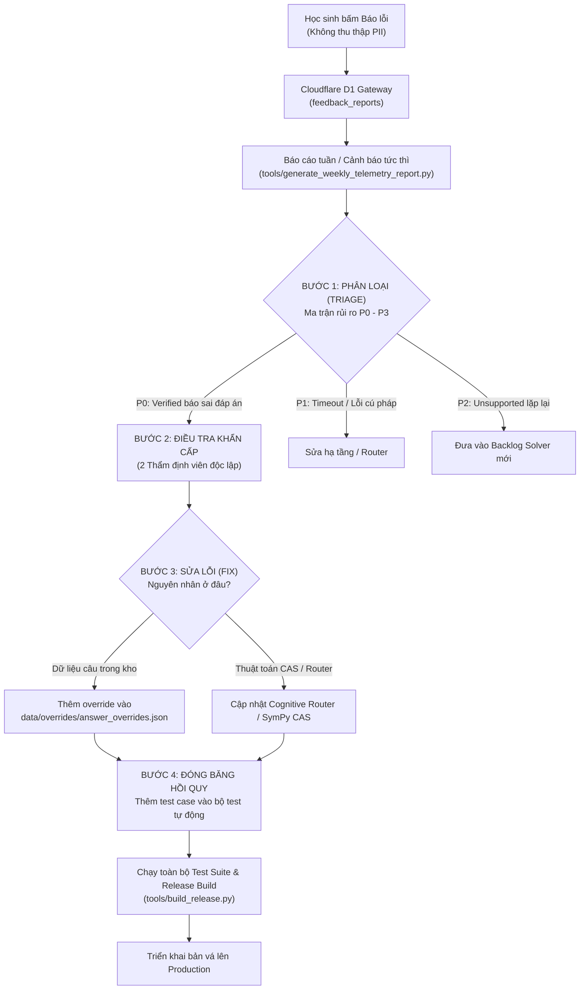

# QUY TRÌNH XỬ LÝ BÁO LỖI HỌC THUẬT & ĐÓNG BĂNG HỒI QUY (FEEDBACK LOOP)
**Tài liệu vận hành chuẩn (SOP) — Nền tảng PUMKIN.DEV**  
*Mã tài liệu: SOP-ACAD-07 — Phiên bản: 1.0 — Ngày ban hành: 21/10/2026*

---

## 1. MỤC TIÊU VÀ NGUYÊN TẮC VẬN HÀNH
Hệ thống AI và mô hình CAS có thể gặp các trường hợp ngoại lệ ngoài đời thực ("edge-cases"). Mục tiêu của quy trình **Feedback Loop** là:
1. Phát hiện sớm nhất các ca "sai mà tự tin" (hệ thống gắn nhãn `verified` nhưng kết quả thực tế bị sai).
2. Xử lý triệt để nguyên nhân gốc rễ (Root Cause Analysis).
3. **Bắt buộc đóng băng ca lỗi thành ca kiểm thử tự động (Regression Test Case)** để lỗi đó **vĩnh viễn không bao giờ tái diễn** ở các bản cập nhật sau.



---

## 2. CHI TIẾT 4 BƯỚC VẬN HÀNH CHUẨN

### BƯỚC 1: PHÂN LOẠI TỰ ĐỘNG & XẾP HÀNG ƯU TIÊN (TRIAGE)
Mỗi báo cáo gửi về từ `feedback_reports` được hệ thống tự động gán mức độ ưu tiên:

| Mức độ | Tiêu chí nhận diện | Thời hạn phản hồi (SLA) | Hành động xử lý |
| :--- | :--- | :---: | :--- |
| **P0 (Khẩn cấp)** | Câu hỏi có `verified_when_reported = 1` và lý do là `WRONG_ANSWER`. Nguy cơ cao là ca "sai mà tự tin". | **Trong vòng 24 giờ** | Cách ly câu hỏi tạm thời, kích hoạt thẩm định toán học khẩn cấp. |
| **P1 (Nghiêm trọng)** | Lỗi `FORMULA_ERROR` (hỏng render KaTeX), `TIMEOUT` hoặc tỷ lệ lỗi cụm tăng đột biến. | **Trong vòng 48 giờ** | Kiểm tra cú pháp biểu thức và tài nguyên Gateway. |
| **P2 (Trung bình)** | Báo lỗi `MISUNDERSTOOD_PROBLEM` hoặc các dạng toán `unsupported` có tần suất báo cáo $\ge 5$ lần/tuần. | **Theo chu kỳ Sprint (1 tuần)** | Đưa vào backlog mở rộng năng lực bộ giải CAS. |
| **P3 (Thấp)** | Góp ý `HARD_TO_UNDERSTAND` (lời giải khó hiểu, cần giải thích kỹ hơn các bước trung gian). | **Theo kế hoạch sư phạm** | Bổ sung thêm gợi ý Socratic Bậc 3 và Bậc 4. |

---

### BƯỚC 2: QUY TRÌNH ĐIỀU TRA ĐỘC LẬP (INVESTIGATION PROTOCOL)
Mọi ca P0 và P1 bắt buộc phải tuân thủ điều lệ **PUMKIN Academic Standards (GEMINI.md)**:

1. **Tái hiện độc lập:**
   - Kỹ sư trích xuất câu hỏi từ mã `question_id` hoặc nội dung đề (nếu học sinh đồng ý gửi).
   - Đưa bài toán vào script kiểm thử cục bộ:
     ```bash
     python -m pytest tests/test_solver_edge_cases.py -k "<question_id>"
     ```
2. **Nguyên tắc Đồng thuận Đa tầng (Multi-Agent Consensus):**
   - Ít nhất **2 chuyên viên toán học** (hoặc 1 chuyên viên + 1 hệ thống kiểm chứng độc lập như SymPy/Mathematica) giải độc lập bằng 2 phương pháp khác nhau.
3. **Rà soát bẫy và điều kiện biên (GEMINI.md Rule 1):**
   - Kiểm tra điều kiện xác định của căn thức $f(x) \ge 0$, phân thức $v(x) \ne 0$, logarit $a>0, a\ne 1, b>0$.
   - Kiểm tra phương trình mặt cầu $R^2 = a^2+b^2+c^2-d > 0$.
   - Kiểm tra xem lời giải có bị chia cho 0 khi xét hai vector cùng phương hay không.
   - Kiểm tra xem có sinh nghiệm ngoại lai khi bình phương hai vế không.

---

### BƯỚC 3: SỬA BỘ GIẢI VÀ DỮ LIỆU (FIXING & PATCHING)

Tùy vào nguyên nhân gốc rễ, áp dụng 1 trong 2 luồng sửa đổi an toàn:

#### Luồng 3A: Lỗi dữ liệu câu hỏi trong ngân hàng đề
- **Quy tắc bất biến:** Tuyệt đối **KHÔNG** sửa thủ công trực tiếp vào file gốc để tránh mất dấu vết lịch sử (Data Lineage).
- **Thực hiện:** Bổ sung bản ghi hiệu đính vào file `data/overrides/answer_overrides.json`:
  ```json
  {
    "question_id": "q_tsa_example_01",
    "reported_date": "2026-10-21",
    "reporter_session": "sess_8f2a1b",
    "error_reason": "WRONG_ANSWER",
    "root_cause": "Quên loại trừ nghiệm ngoại lai làm mẫu bằng 0 ở bước 2",
    "override_correct_answer": 2,
    "override_correct_value": "x = 3",
    "approved_by": "hoi_dong_hoc_thuat_pumkin",
    "approved_date": "2026-10-21"
  }
  ```
- Khi chạy script đóng gói `python tools/build_release.py`, bộ nạp sẽ tự động áp dụng bản ghi đè này, sinh lại gói phát hành sạch và tạo mã hash kiểm tra toàn vẹn.

#### Luồng 3B: Lỗi thuật toán suy luận / CAS / Cognitive Router
- Cập nhật hàm giải toán hoặc logic rút gọn trong `pumkin-math-api`.
- Bổ sung quy tắc nhận diện bẫy nhận thức trong `PumkinErrorClassifier.js` nếu phương án nhiễu bị gắn sai mã misconception.

---

### BƯỚC 4: ĐÓNG BĂNG THÀNH CA KIỂM THỬ HỒI QUY (REGRESSION FREEZING)
**"Một lỗi đã từng phát hiện không được phép xuất hiện lần thứ hai."**

1. Mỗi ca sửa chữa bắt buộc phải được chuyển hóa thành một ca kiểm thử trong bộ test hồi quy:
   - Nếu là câu hỏi trong kho: Thêm vào `tools/test_scoring_regression.mjs`.
   - Nếu là biểu thức toán học: Thêm vào danh sách ca biên của `tools/test_w5_answer_checker.mjs`.
   - Nếu là lỗi sinh đề: Thêm vào `tools/test_w6_isomorphic_generation.mjs`.

2. **Cấu trúc một ca test hồi quy chuẩn:**
   ```javascript
   // Regression Case: Bug Report #FB-20261021-01
   // Context: Câu hỏi q_tsa_example_01 bị báo lỗi sai đáp án do nghiệm ngoại lai
   {
       qid: 'q_tsa_example_01',
       studentAnswer: 'x = 3',
       expectedVerdict: 'correct',
       description: 'REGRESSION: Đảm bảo nghiệm x = 3 được chấm đúng sau khi đã loại trừ x = -1'
   }
   ```

3. **Chạy kiểm thử toàn diện trước khi phát hành:**
   ```powershell
   node tools/test_w4_tutor_pathways.mjs
   node tools/test_w5_answer_checker.mjs
   node tools/test_w6_isomorphic_generation.mjs
   node tools/test_w7_telemetry_and_privacy.mjs
   python tools/build_release.py
   ```
   Chỉ khi **100% các bài kiểm tra chạy xanh**, bản vá mới được phép đẩy lên production.

---

## 3. LƯU TRỮ VÀ TIÊU HỦY DỮ LIỆU BÁO LỖI
- Mọi bản ghi báo lỗi trong `feedback_reports` sau khi đã được phân tích và đóng băng thành ca kiểm thử sẽ được cập nhật trạng thái `triage_status = 'resolved'`.
- Sau đúng 90 ngày kể từ ngày tạo, bản ghi sẽ tự động được xóa vĩnh viễn khỏi Cloudflare D1 theo chính sách bảo vệ dữ liệu cá nhân. Ca kiểm thử tự động (đã được khử toàn bộ thông tin người dùng) sẽ được lưu lại vĩnh viễn trong kho mã nguồn làm tài sản chất lượng của dự án.
